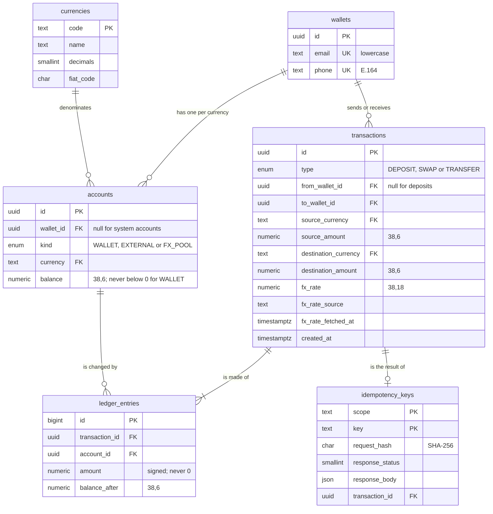

# CurrencyMesh

CurrencyMesh is a REST API sandbox for cross-border stablecoin payments. It connects five
mock stablecoins (cNGN, cGHS, cXAF, USDx and EURx) into one mesh, where any currency can be
swapped or sent into any other at live FX rates.

- **Correct money:** amounts never pass through a float, and every transaction is recorded in a
  double-entry ledger that must balance.
- **No negative balances,** even when many requests spend the same funds at once.
- **No double processing:** a retry with the same `Idempotency-Key` returns the first result.
- **FX failures do not stop payments:** the API falls back to the last good rates, then a built-in
  table, and says so in the response.

It moves no real money and has no authentication, as the brief allows.

## Contents

- [Quick start](#quick-start)
- [Running the tests](#running-the-tests)
- [Tech stack](#tech-stack)
- [Why PostgreSQL](#why-postgresql)
- [API walkthrough](#api-walkthrough)
- [Data model](#data-model)
- [Money precision, idempotency, concurrency and FX failures](#how-the-hard-parts-work)
- [Errors](#errors)
- [API documentation](#api-documentation)
- [Project structure](#project-structure)
- [Assumptions](#assumptions)
- [Known limitations](#known-limitations)
- [What I added and left out, and why](#what-i-added-beyond-the-brief-and-why)
- [What I would do with more time](#what-i-would-do-with-more-time)

## Quick start

**Before you start:** install [Docker](https://docs.docker.com/get-docker/) with Docker Compose,
and make sure **Docker is running**. On Windows and macOS, that means opening Docker Desktop and
waiting until it says it is running. `docker info` should print server details, not an error.

```bash
git clone https://github.com/Mukhtar502/operation-borderless.git
cd operation-borderless
docker compose up --build
```

This one command starts PostgreSQL, applies the database migrations, then starts the API. Docker
installs all dependencies inside the image, so you do not need Node.js, Yarn, `yarn install` or a
`.env` file to run the API. The first build takes a few minutes. The API is ready when the logs show
`CurrencyMesh API listening`.

To stop it, press `Ctrl+C` or run `docker compose down`. Your data is kept. To delete the data as
well, run `docker compose down -v`.

| What               | Where                          |
| ------------------ | ------------------------------ |
| API                | <http://localhost:3000/v1>     |
| Swagger UI         | <http://localhost:3000/docs>   |
| Liveness check     | <http://localhost:3000/health> |
| Readiness check    | <http://localhost:3000/ready>  |
| Postgres for tools | `localhost:5433`               |

Postgres uses host port 5433 so it does not clash with a local install. If a port is taken,
change it: `API_HOST_PORT=3100 DB_HOST_PORT=5544 docker compose up --build`.

**Demo data is optional.** This command creates three wallets with deposits, a swap and a
transfer. It is safe to run more than once:

```bash
docker compose run --rm migrate node dist/db/seed.js
```

**If something goes wrong:**

- `Cannot connect to the Docker daemon`: Docker is not running. Start it and try again.
- `port is already allocated`: choose free ports, as shown above.

### Running without Docker

You need Node.js 22 LTS, Yarn 1 and a PostgreSQL database. Settings are listed in `.env.example`.

```bash
cp .env.example .env
docker compose up -d db   # or point DATABASE_URL at your own Postgres
yarn install
yarn db:migrate
yarn db:seed              # optional
yarn dev
```

## Running the tests

You need Node.js 22 LTS, Yarn 1 and **Docker running**. The API itself does not need to be up.

```bash
yarn install
yarn test
```

`yarn test` starts a temporary PostgreSQL container with
[Testcontainers](https://testcontainers.com/), applies the migrations and runs every test
against a real database. There is nothing to configure. To use an existing database instead,
set `TEST_DATABASE_URL`; the tests delete its data.

`yarn install` may print a `gyp` error for `cpu-features`. It is an optional add-on of a
Testcontainers dependency, and the install and tests still succeed.

| Command                 | What it does                                             |
| ----------------------- | -------------------------------------------------------- |
| `yarn test`             | All tests                                                |
| `yarn test:unit`        | Pure logic only; no database needed                      |
| `yarn test:integration` | Real HTTP requests against a real database               |
| `yarn test:coverage`    | All tests with a coverage report                         |
| `yarn test:postman`     | Runs the Postman collection against the API on port 3000 |
| `yarn lint`             | ESLint with type-aware rules                             |
| `yarn typecheck`        | TypeScript in strict mode                                |
| `yarn format:check`     | Prettier                                                 |

**What the tests prove, beyond the normal paths:**

- 25 parallel debits of 10 against a balance of 100 let exactly 10 through.
- Two wallets paying each other at the same moment do not deadlock.
- 10 requests with one idempotency key do the work once, and all get the same response.
- A retry gets its first result even after the rate moves or the FX provider goes down.
- Every balance equals the sum of its ledger entries, and every transaction balances.
- The database still rejects bad data when the application code is bypassed.
- Real responses match the documented schemas, so the API docs cannot drift from the code.

## Tech stack

| Area      | Choice                            | Why                                                                  |
| --------- | --------------------------------- | -------------------------------------------------------------------- |
| Language  | Node.js 22 LTS, TypeScript        | Strict mode, plus checks for unsafe index access and optional fields |
| Framework | Express 5                         | Small and explicit, so the money logic stays easy to read            |
| Database  | PostgreSQL 16                     | See [Why PostgreSQL](#why-postgresql)                                |
| Queries   | Kysely                            | Type-checked SQL that still shows the locks and transactions plainly |
| Money     | decimal.js                        | Exact decimal maths; JavaScript numbers are never used for amounts   |
| FX rates  | open.er-api.com                   | Free, needs no key, and covers NGN, GHS and XAF                      |
| Tests     | Vitest, Supertest, Testcontainers | Native ESM support; tests run against real Postgres, not a mock      |
| Docs      | OpenAPI 3.1 from Zod, Swagger UI  | Generated from the validation schemas, so the docs stay accurate     |
| Logging   | pino                              | Structured JSON logs with a request id on every line                 |
| Tooling   | Yarn, ESLint, Prettier, Docker    | As the brief asks                                                    |

## Why PostgreSQL

This system's main job is to keep money correct, and PostgreSQL can enforce that itself:

- **Transactions across tables:** a transfer changes balances and writes a transaction, ledger
  entries and an idempotency record. They all succeed or fail together.
- **Row locks:** `SELECT ... FOR UPDATE` stops two requests spending the same funds.
- **Exact decimals:** `NUMERIC` stores money exactly.
- **Rules in the database:** `CHECK` constraints, unique indexes and triggers protect the data
  even if the application has a bug.

MongoDB has multi-document transactions, but this data is relational and every operation needs
those guarantees. MySQL could also work. PostgreSQL's deferred constraint triggers let the
database check at commit that the ledger balances, which is a safeguard I wanted.

## API walkthrough

These are real responses from the running API. The easiest way to try them is Swagger UI at
<http://localhost:3000/docs>: open an endpoint, press **Try it out**, fill in the fields and press
**Execute**. Then copy ids from one response into the next request.

For the `curl` commands, first run `API=http://localhost:3000/v1`, and after creating a wallet, run
`WALLET=<the id you received>`.

Three rules apply to every request:

- Success returns `{ "data": ... }`, and amounts are decimal strings with 6 decimal places.
- Send amounts as strings: `"100.50"`, not `100.50`.
- Deposits, swaps and transfers need an `Idempotency-Key` header. **You choose the key**: any unique
  text, and a UUID is best. Use a new key for each new payment, and the same key when retrying one.

### 1. Create a wallet

Send an email, a phone number in international format, or both. Each can own only one wallet.

```bash
curl -X POST $API/wallets -H 'Content-Type: application/json' \
  -d '{ "email": "ada@example.com" }'
```

`201 Created`, with `Location: /v1/wallets/d5ab198d-f1dc-40cf-80e4-26966580db3b`

```json
{
  "data": {
    "id": "d5ab198d-f1dc-40cf-80e4-26966580db3b",
    "email": "ada@example.com",
    "phone": null,
    "totalUsd": "0.000000",
    "balances": [
      { "currency": "cNGN", "amount": "0.000000" },
      { "currency": "cGHS", "amount": "0.000000" },
      { "currency": "cXAF", "amount": "0.000000" },
      { "currency": "USDx", "amount": "0.000000" },
      { "currency": "EURx", "amount": "0.000000" }
    ],
    "createdAt": "2026-10-31T00:27:41.521Z"
  }
}
```

A second wallet with the same email returns `409 WALLET_ALREADY_EXISTS`, even written as
`ADA@example.com`. So does the same phone written differently: `+234 803 646 1409` and
`+2348036461409` are one number.

### 2. Deposit

```bash
curl -X POST $API/wallets/$WALLET/deposits -H 'Content-Type: application/json' \
  -H 'Idempotency-Key: dep-001' \
  -d '{ "currency": "USDx", "amount": "100.00" }'
```

`201 Created`, with `Idempotent-Replayed: false`

```json
{
  "data": {
    "id": "f1d357a8-86ab-4282-bc9f-9365fc6137f5",
    "type": "DEPOSIT",
    "fromWalletId": null,
    "toWalletId": "d5ab198d-f1dc-40cf-80e4-26966580db3b",
    "source": { "currency": "USDx", "amount": "100.000000" },
    "destination": { "currency": "USDx", "amount": "100.000000" },
    "fx": {
      "rate": "1",
      "source": "par",
      "provider": null,
      "refreshedAt": "2026-10-31T00:27:41.583Z"
    },
    "createdAt": "2026-10-31T00:27:41.588Z"
  }
}
```

Send the same request again and you get the same response with `Idempotent-Replayed: true`. The
balance does not change. Reusing the key with a different amount returns
`422 IDEMPOTENCY_KEY_REUSED`.

`"source": "par"` means no currency conversion happened, so the rate is exactly 1.

### 3. Swap

```bash
curl -X POST $API/wallets/$WALLET/swaps -H 'Content-Type: application/json' \
  -H 'Idempotency-Key: swap-001' \
  -d '{ "fromCurrency": "USDx", "toCurrency": "cNGN", "amount": "40" }'
```

`201 Created`

```json
{
  "data": {
    "id": "3b8c4327-3a66-459c-97a1-964241ee6f9c",
    "type": "SWAP",
    "fromWalletId": "d5ab198d-f1dc-40cf-80e4-26966580db3b",
    "toWalletId": "d5ab198d-f1dc-40cf-80e4-26966580db3b",
    "source": { "currency": "USDx", "amount": "40.000000" },
    "destination": { "currency": "cNGN", "amount": "53848.952920" },
    "fx": {
      "rate": "1346.223823",
      "source": "live",
      "provider": "open.er-api.com",
      "refreshedAt": "2026-10-31T00:27:36.462Z"
    },
    "createdAt": "2026-10-31T00:27:41.620Z"
  }
}
```

### 4. Transfer

`destinationCurrency` is optional. Leave it out to send and receive the same currency.

```bash
curl -X POST $API/transfers -H 'Content-Type: application/json' \
  -H 'Idempotency-Key: transfer-001' \
  -d '{
    "fromWalletId": "d5ab198d-f1dc-40cf-80e4-26966580db3b",
    "toWalletId": "9c2f8c8c-5e0f-4aa3-b14f-00855ee53373",
    "sourceCurrency": "USDx",
    "destinationCurrency": "cGHS",
    "amount": "20"
  }'
```

`201 Created`

```json
{
  "data": {
    "id": "32543deb-0ae6-4e3a-8711-02d80f188663",
    "type": "TRANSFER",
    "fromWalletId": "d5ab198d-f1dc-40cf-80e4-26966580db3b",
    "toWalletId": "9c2f8c8c-5e0f-4aa3-b14f-00855ee53373",
    "source": { "currency": "USDx", "amount": "20.000000" },
    "destination": { "currency": "cGHS", "amount": "233.161360" },
    "fx": {
      "rate": "11.658068",
      "source": "live",
      "provider": "open.er-api.com",
      "refreshedAt": "2026-10-31T00:27:36.462Z"
    },
    "createdAt": "2026-10-31T00:27:41.640Z"
  }
}
```

Spending more than the balance moves nothing and returns `422`:

```json
{
  "error": {
    "code": "INSUFFICIENT_FUNDS",
    "message": "Insufficient USDx balance",
    "details": { "currency": "USDx", "available": "40.000000", "required": "1000.000000" },
    "requestId": "43d524e6-7427-4470-a646-ea826706e4eb"
  }
}
```

### 5. Balances and total in USD

There are two views, and both show the total:

- `GET /v1/wallets/{walletId}` is the **summary**: who owns the wallet, what it holds, the total.
- `GET /v1/wallets/{walletId}/balances` is the **breakdown**, shown here: each balance's USD
  value and the rates used.

```bash
curl $API/wallets/$WALLET/balances
```

`200 OK`

```json
{
  "data": {
    "walletId": "d5ab198d-f1dc-40cf-80e4-26966580db3b",
    "totalUsd": "80.000000",
    "fx": {
      "source": "live",
      "provider": "open.er-api.com",
      "refreshedAt": "2026-10-31T00:27:36.462Z",
      "providerUpdatedAt": "2026-10-30T00:02:31.000Z"
    },
    "balances": [
      { "currency": "cNGN", "amount": "53848.952920", "usdValue": "40.000000" },
      { "currency": "cGHS", "amount": "0.000000", "usdValue": "0.000000" },
      { "currency": "cXAF", "amount": "0.000000", "usdValue": "0.000000" },
      { "currency": "USDx", "amount": "40.000000", "usdValue": "40.000000" },
      { "currency": "EURx", "amount": "0.000000", "usdValue": "0.000000" }
    ]
  }
}
```

### 6. Transaction history

Newest first, including transfers sent and received. Filters: `type` (`DEPOSIT`, `SWAP`,
`TRANSFER`) and `currency`, which matches either side of a transaction. `limit` is 1 to 100.

```bash
curl "$API/wallets/$WALLET/transactions?limit=2"
```

`200 OK`, with the second item shortened here

```json
{
  "data": [
    {
      "id": "32543deb-0ae6-4e3a-8711-02d80f188663",
      "type": "TRANSFER",
      "direction": "OUT",
      "fromWalletId": "d5ab198d-f1dc-40cf-80e4-26966580db3b",
      "toWalletId": "9c2f8c8c-5e0f-4aa3-b14f-00855ee53373",
      "source": { "currency": "USDx", "amount": "20.000000" },
      "destination": { "currency": "cGHS", "amount": "233.161360" },
      "fx": {
        "rate": "11.658068",
        "source": "live",
        "provider": "open.er-api.com",
        "refreshedAt": "2026-10-31T00:27:36.462Z"
      },
      "createdAt": "2026-10-31T00:27:41.640Z"
    },
    { "id": "3b8c4327-3a66-459c-97a1-964241ee6f9c", "type": "SWAP", "direction": "INTERNAL" }
  ],
  "pagination": {
    "limit": 2,
    "hasMore": true,
    "nextCursor": "M2I4YzQzMjctM2E2Ni00NTljLTk3YTEtOTY0MjQxZWU2Zjlj"
  }
}
```

For the next page, send `?cursor=<nextCursor>`. I used cursors rather than page numbers because a
payment arriving between pages would shift page numbers, showing a row twice or skipping one.

### 7. One transaction

`GET /v1/transactions/{transactionId}` returns the same transaction object as the response that
created it. An unknown id returns `404 TRANSACTION_NOT_FOUND`.

### 8. Current rates

All 20 pairs between different currencies. The list is shortened here.

```bash
curl $API/rates
```

`200 OK`

```json
{
  "data": {
    "source": "live",
    "provider": "open.er-api.com",
    "refreshedAt": "2026-10-31T00:27:36.462Z",
    "providerUpdatedAt": "2026-10-30T00:02:31.000Z",
    "rates": [
      {
        "from": "cNGN",
        "to": "cGHS",
        "rate": "0.008659828923559318",
        "refreshedAt": "2026-10-31T00:27:36.462Z",
        "providerUpdatedAt": "2026-10-30T00:02:31.000Z"
      }
    ]
  }
}
```

`refreshedAt` is when this API last fetched the rate. `providerUpdatedAt` is when the provider
published it. The provider updates once a day, so the two can differ by many hours.

## Data model



The tables and their rules are created by the migrations in `src/db/migrations/`. `src/db/schema.ts`
describes the same tables as TypeScript types, so every query is type-checked.

### Double-entry ledger

Balances are not simply edited. Every transaction writes ledger entries that add up to **zero in
each currency**, so money can only move and never appear from nowhere. Two kinds of system account
make this work:

- **`EXTERNAL`** is the simulated outside world. Deposits come from it, so its negative balance
  always equals the total ever deposited.
- **`FX_POOL`** is the other side of every conversion.

Here are the entries for the swap in the walkthrough, 40 USDx into 53848.95292 cNGN:

| Account      | Currency | Amount          |
| ------------ | -------- | --------------- |
| Ada's wallet | USDx     | `-40.000000`    |
| FX pool      | USDx     | `+40.000000`    |
| FX pool      | cNGN     | `-53848.952920` |
| Ada's wallet | cNGN     | `+53848.952920` |

### Rules the database enforces

These hold even if the application code has a bug:

| Rule                                                                     | How                                  |
| ------------------------------------------------------------------------ | ------------------------------------ |
| A wallet balance can never go below zero                                 | `CHECK` constraint                   |
| One wallet per email and per phone                                       | Unique constraints                   |
| A wallet needs an email or a phone                                       | `CHECK` constraint                   |
| Each transaction type has a valid shape, e.g. a swap stays in one wallet | `CHECK` constraint                   |
| Each transaction's entries sum to zero per currency                      | Deferred trigger, checked at commit  |
| The ledger is append-only: fixes are new entries                         | Trigger blocks `UPDATE` and `DELETE` |

## How the hard parts work

### Money precision

- **Amounts are strings in the API.** `"100.50"` is accepted. A JSON number such as `100.5` is
  rejected, because it may already have lost precision before reaching the server.
- **No floats anywhere.** Amounts are `NUMERIC(38,6)` in the database, strings in between and
  `decimal.js` for maths. Rates are `NUMERIC(38,18)`.
- **Six decimal places,** the same as USDC. More decimals, zero, negatives, exponents such as `1e5` and
  more than 1 trillion per request are rejected.
- **Conversions round down,** so a conversion can never create money. The tiny remainder stays
  in the FX pool, and the ledger still balances. If an amount rounds to zero, the request gets
  `422 AMOUNT_TOO_SMALL` so nobody pays for nothing.
- **The recorded rate reproduces the recorded amount,** so any transaction can be checked later.
- **USD values round half-even per line,** and `totalUsd` is the sum of those lines, so the numbers
  a client sees always add up. This is for display only: no money moves at this rounding.

### Idempotency

Deposits, swaps and transfers require an `Idempotency-Key` header. Keys belong to a wallet: the
wallet receiving a deposit, the wallet doing a swap or the sender of a transfer.

Claiming the key, moving the money and saving the response all happen in **one database
transaction**, so they cannot get out of step:

| Situation                               | Result                                                                                |
| --------------------------------------- | ------------------------------------------------------------------------------------- |
| First request                           | Work runs and the response is saved                                                   |
| Retry after success                     | The exact same response, with `Idempotent-Replayed: true`                             |
| Same key at the same moment             | Postgres makes the second request wait for the first, then it replays that result     |
| Same key, different request             | `422 IDEMPOTENCY_KEY_REUSED`                                                          |
| The work fails, e.g. insufficient funds | Everything rolls back, including the key, so the client can fix the problem and retry |

- A request's identity is a SHA-256 hash of its meaning, so `"25"` and `"25.00"` are the same
  request.
- The FX rate is not part of that identity. Retries are checked **before** a rate is looked up, so a
  retry gets its first result even if the rate has moved or the provider is down.

### Concurrency

All balance changes go through one place, `src/modules/ledger/ledger.service.ts`. Inside a database
transaction it:

1. Checks the postings balance to zero per currency.
2. Locks every affected account with `SELECT ... FOR UPDATE`, **always in id order**. Everyone takes
   locks in the same order, so two transfers in opposite directions cannot deadlock.
3. Checks the funds while holding the locks, so two requests cannot both spend the same money.
4. Writes the transaction, the ledger entries and the new balances.

The FX rate is fixed **before** the transaction starts, so no locks are held during a network call.
Timeouts on queries and idle transactions stop a stuck request from holding locks forever.

### FX rate failures

The API never fails a request because the FX provider is down. It falls back step by step:

| Step | `source` | When                                                     | Rates used                          |
| ---- | -------- | -------------------------------------------------------- | ----------------------------------- |
| 1    | `live`   | Normal; cached for 5 minutes                             | From open.er-api.com                |
| 2    | `stale`  | Provider failing; last good rates are under 48 hours old | Last good rates                     |
| 3    | `static` | No live rates yet, or the last good ones are too old     | Built-in table in `static-rates.ts` |

- A slow provider times out after 5 seconds, and a failed one is not called again for 30 seconds.
- Concurrent requests share one provider call instead of all hitting it.
- A response with a missing currency, a zero rate or the wrong format is rejected whole, so rates
  from different sources are never mixed.
- Rates load when the server starts, so the first request does not pay for a slow first connection.

Every transaction records which source and provider it used, so a conversion made on fallback rates
can always be identified later.

## Errors

Every error has the same shape, shown in the [transfer example](#4-transfer). `code` is stable for
programs, `message` is plain English, `details` is optional extra information, and `requestId`
matches the server logs.

| Status | Meaning                                            |
| ------ | -------------------------------------------------- |
| 400    | Invalid input                                      |
| 404    | Wallet, transaction or route not found             |
| 405    | Wrong method for this URL (see the `Allow` header) |
| 409    | A wallet already exists for this email or phone    |
| 413    | Request body is too large                          |
| 415    | Request body is not JSON                           |
| 422    | Business rule failed, e.g. insufficient funds      |
| 500    | Unexpected server error                            |

## API documentation

- **Swagger UI:** <http://localhost:3000/docs>, to read about and try every endpoint.
- **OpenAPI 3.1 spec:** [`docs/openapi.json`](docs/openapi.json). It is generated from the same Zod
  schemas that validate requests; refresh it with `yarn docs:openapi`. A test fails if it is out of
  date, and contract tests check real responses against it.
- **Postman collection:**
  [`docs/CurrencyMesh.postman_collection.json`](docs/CurrencyMesh.postman_collection.json). Import it
  and press **Run collection**, or run `yarn test:postman` with the API running. It goes through the
  whole API in order, with a check on every request.

## Project structure

Each feature is a module with the same layers: **routes** map URLs to a **controller**, the controller
validates input with its **validation** schemas and calls the **service**, and the service holds the
business logic. Services never touch Express request or response objects.

```
src/
├── app.ts                 Express app: middleware, /v1 routes, docs, error handling
├── server.ts              Starts the server; graceful shutdown
├── container.ts           Builds every service and wires dependencies together
├── config/env.ts          Validated environment variables
├── routes/index.ts        Mounts every module under /v1
├── middleware/            Errors, 404, 405, JSON-only bodies, request validation
├── modules/
│   ├── wallets/           routes · controller · service · validation
│   ├── deposits/          routes · controller · service · validation
│   ├── swaps/             routes · controller · service · validation
│   ├── transfers/         routes · controller · service · validation
│   ├── transactions/      routes · controller · service · validation · mapper
│   ├── rates/             routes · controller · FX service, live provider, static table
│   ├── ledger/            The only code that changes balances (internal, no routes)
│   └── idempotency/       Safe retries for money requests (internal, no routes)
├── domain/                Business rules: money, currencies, conversion, phone and email
├── db/                    Kysely client, data models (schema.ts), migrations, seed
├── docs/                  OpenAPI document, response schemas, examples
└── lib/                   Error types, logger
test/
├── unit/                  Pure logic, no database
├── integration/           Real HTTP requests against a real Postgres
└── helpers/               Test app, fake FX provider, ledger checks
```

## Assumptions

- **Stablecoins track their fiat currency 1:1** (cNGN = NGN, USDx = USD), so fiat reference rates apply
  directly, and one USDx counts as one US dollar in the USD total.
- **Conversions use the provider's reference rate,** with no fee or spread. The FX pool has unlimited
  funds, so a conversion never fails for lack of liquidity.
- **Deposits are always accepted,** because they are simulated.
- **A wallet can have both an email and a phone.** Phones need a country code, because the API serves
  several countries and guessing one would be unsafe.
- **A rejected request is not "processed".** Retrying after a `422` runs the checks again, so a transfer
  that failed for lack of funds can succeed after a deposit.

## Known limitations

These are acceptable for a sandbox and would need work before handling real money:

- **No authentication or rate limiting.** Anyone who has a wallet id can move its money and read its
  history.
- **Shared system accounts are a bottleneck.** Deposits and conversions lock shared `EXTERNAL` and
  `FX_POOL` rows, so they run one at a time per currency.
- **Requests can wait on the FX provider.** When the 5-minute cache expires, the next request waits for
  the refresh, for up to 5 seconds.
- **Rates are daily and cached per process.** The provider updates once a day, static rates need updating
  by hand, and several API instances could briefly use different rates.
- **Idempotency keys never expire,** so that table keeps growing.

## What I added beyond the brief, and why

- **Double-entry ledger:** lets the system prove its balances, because each balance must equal the sum of
  its entries.
- **Both OpenAPI and Postman:** the brief asks for either. OpenAPI documents the contract, and the Postman
  collection runs the whole flow in one click.
- **Testcontainers:** `yarn test` needs no database setup, and locks and constraints are tested on real
  PostgreSQL.
- **Seed command:** gives you data to explore straight away.
- **Security headers and database timeouts:** they cost little, and a stuck request cannot hold account locks
  forever.

## What I left out, and why

The brief asks for a focused API, and for a cache or queue "only where it earns its place".

- **BullMQ:** balances must update immediately, and every operation finishes inside one database transaction,
  so there is no background work for a queue. It would also need Redis. I would add it for slow or retryable
  work such as webhooks, real settlement or reconciliation.
- **Redis:** idempotency records must commit in the same transaction as the money, so they belong in
  PostgreSQL. The FX cache is small and works in memory on one instance. I would add Redis to share rates
  across several instances.
- **RabbitMQ:** there are no other services to send messages to.
- **Authentication and rate limiting:** the brief does not require authentication, and a useful rate limit
  depends on knowing who the caller is. Both come first before real use.
- **Fees and FX spread:** not in the brief, and they would make it harder to check that conversions are correct.

## What I would do with more time

1. Add authentication, per-wallet authorization and rate limiting.
2. Refresh FX rates in the background, so requests never wait on the provider, and save each snapshot so
   fallback rates survive a restart.
3. Reduce contention on the system accounts, then load test the result.
4. Expire old idempotency keys, and add a job that checks balances against the ledger and alerts on any
   difference. This is where a job queue would earn its place.
5. Add metrics and tracing: request rates, FX fallback counts and lock wait times.

## Acknowledgements

Live FX rates are provided by [Exchange Rate API](https://www.exchangerate-api.com).
